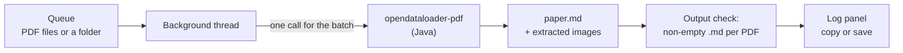

<div align="center">


# PDF to Markdown Converter

**A small Linux desktop app that turns a queue of PDF files into Markdown, one `.md` file per PDF, with figures saved as images if you want them.**

[](https://github.com/AbdelRahman-Madboly/pdf-to-markdown/actions/workflows/ci.yml)


[How it works](#how-it-works) · [Install](#install) · [Run](#run) · [What it does not do](#what-it-does-not-do) · [Develop](#develop)

</div>

## Why PDF to Markdown Converter

Converting PDFs to Markdown usually means a command line, a set of flags and checking the output by
hand. This app is a Tkinter window around
[`opendataloader-pdf`](https://pypi.org/project/opendataloader-pdf/): queue PDFs, pick an output
folder, press Convert, and get one `.md` file per PDF. After the run it tells you which PDFs, if any,
did not produce a Markdown file.

## Highlights

- **Queue files or folders.** Add single PDFs or every `*.pdf` in a folder (not recursive);
  duplicates are skipped.
- **One call per batch.** The whole queue is converted in one `opendataloader-pdf` call, so Java
  starts once for the batch.
- **Images optional.** Extract images next to the Markdown (on by default) or leave them out.
- **Output check.** After the run, every PDF is checked for a non-empty `.md` file and any that did
  not produce one are listed.
- **A log you keep.** Copy the log or save it into the output folder.

## How it works



The batch runs on a background thread, away from the window. The progress bar is
indeterminate because the upstream call does not report progress per file.

Output for `paper.pdf`:

```text
paper.md             plus a folder of extracted images when Extract images is on and the PDF has figures
```

## Status

1.0.0. Used daily on Ubuntu, no known bugs. The tests run in CI on every push.

## Install

```bash
sudo apt install python3 python3-tk openjdk-17-jre    # Java 11 or newer is needed
pip install -r requirements.txt
./install_pdf_to_markdown_converter.sh
```

The installer writes the `pdf-to-markdown-converter` command to `~/.local/bin`, a menu entry in
`~/.local/share/applications` and a launcher on the Desktop. It picks a Python that has both Tkinter
and `opendataloader-pdf` (a Miniconda or Anaconda one first, if present). Run it again after moving the
folder.

## Run

```bash
pdf-to-markdown-converter            # after installing
python3 pdf_to_markdown_converter.py # straight from the folder
python3 -m src.pdf_markdown_converter
```

## What it does not do

- No OCR: a scanned PDF with no text layer gives little or no text.
- No per-file progress or cancel button: the upstream call runs the batch as one job.
- No password prompt for encrypted PDFs, and no settings are remembered between runs.
- Linux only (tested on Ubuntu); it uses `xdg-open` to open the output folder.

## Develop

```bash
pip install -r requirements.txt pytest
python3 -m pytest -q
```

The tests build a one-page PDF by hand and convert it for real; that test is skipped when Java is not
installed. The window tests build the real window hidden and are skipped when there is no display
(CI runs them under `xvfb-run`).

## Files

| File | Purpose |
|---|---|
| `src/pdf_markdown_converter/converter.py` | The conversion call and its error messages, no GUI code |
| `src/pdf_markdown_converter/app.py` | Tkinter window, queue, background thread, log |
| `src/pdf_markdown_converter/config.py` | Names, default output folder, colours |
| `pdf_to_markdown_converter.py` | Launcher for running straight from the folder |
| `install_pdf_to_markdown_converter.sh` | Command, menu entry and Desktop launcher |
| [`docs/ARCHITECTURE.md`](docs/ARCHITECTURE.md) | Module layout and design rules |

## License

MIT, see [LICENSE](LICENSE).

## Author

Designed and built by **Abdel Rahman Mohamad EL-Sayed** ([@AbdelRahman-Madboly](https://github.com/AbdelRahman-Madboly)).
